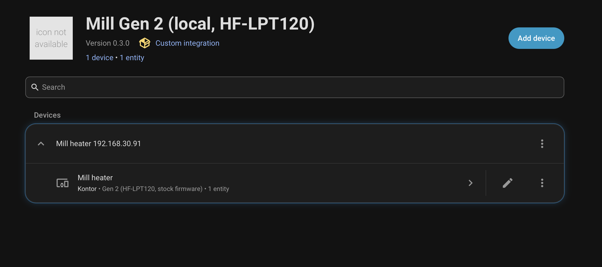
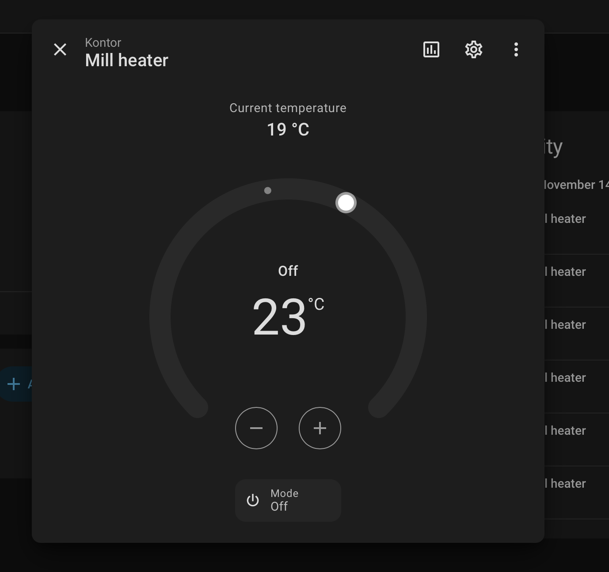

# mill-heater-local

Local control of **Mill Gen 2 Wi-Fi heaters** (HF-LPT120 module) from Home
Assistant, with no cloud.

The heater's Wi-Fi module ships with Mill/AbleCloud firmware that disables
every local interface, and the cloud it depended on is gone. This project
documents the hardware and protocol, provides a guide and tooling to flash
the module with High-Flying's stock firmware (a transparent TCP ⇄ UART
bridge), and ships a **local-push Home Assistant integration** on top.

- **Tested on:** Mill Gen 2 glass panel heater, HF-LPT120, HSF 2.0.10-2 → 2.0.10-11
- **Home Assistant:** 2025.1+ (developed on 2026.11)
- **Control:** target 5–35 °C, heating on/off, room temperature, heating demand
- **Updates:** pushed by the heater MCU (no polling)

> Not affiliated with Mill or High-Flying. Flashing is one-way over Wi-Fi and
> removes Mill app support. You do this at your own risk. Read
> [docs/FLASHING.md](docs/FLASHING.md) before you start.

## Why existing approaches fail on this heater

Many guides and projects target the Mill Gen 2 heater. On an HF-LPT120-based
glass heater none of them work as shipped. The reasons are in the module
firmware, not the network:

- **The Mill app never provisions the module.** Pairing times out, and the
  module keeps its placeholder station credentials (`AT+WSSSID -> 111111`,
  `AT+WSKEY -> …,222222222`): the app's Wi-Fi credentials never reach it.
  Router, VPN or phone-permission tweaks do not change that. The AbleCloud
  backend the app depends on (`AT+APPVER -> ZC_version[1.0.8]`) is no longer
  usable either, so even a provisioned module has no working cloud path.
- **There is no local interface to talk to.** The Mill/AbleCloud firmware
  disables the module's UART bridge: TCP 8899 and TCP 80 are refused, and a
  full TCP scan finds nothing open, even though the stored configuration says
  `TCP,Server,8899`. `AT+RELD` restores Mill's own defaults, so a factory
  reset does not help. Socket B, UDP server mode and the other bridge commands
  are removed or ignored. Anything that expects to "just connect to the
  heater" over the LAN has nothing to connect to.
- **Home Assistant's built-in Mill integration** needs either the cloud
  account path (broken, as above) or the local HTTP API of newer heater
  generations. The Gen 2 HF-LPT120 module has neither.
- **Captured frames do not transfer one-to-one.** The published command
  frames (e.g. MillHeat-ESPHome) are byte-correct, but they come from panel
  heaters:
  - On this glass heater, `0x44`, documented as "power", actually switches to
    an 8 °C mode; the real on/off is `0x47`.
  - The status (`0xc9`) layout differs: those decoders read the setpoint as
    the room temperature and read power/fan from bytes that are zero or the
    checksum.
- **Listen-only clients get disconnected every 300 s.** Even with a working
  bridge, the module drops clients that never transmit (`AT+TCPTO`), which
  looks like a flaky heater.

What works is replacing the vendor firmware with High-Flying's stock firmware.
That exposes the MCU UART on TCP 8899. Then use the opcodes and status map
verified on this heater ([docs/PROTOCOL.md](docs/PROTOCOL.md)) and a client
that keeps the link alive. Details and logs:
[docs/FINDINGS.md](docs/FINDINGS.md) §3–§7.

## Documentation

| Document | Contents |
|---|---|
| [docs/FINDINGS.md](docs/FINDINGS.md) | Hardware, vendor firmware behaviour, open ports, the UDP 48899 AT interface, firmware images and OTA, `AT+TCPTO`, security, open questions |
| [docs/PROTOCOL.md](docs/PROTOCOL.md) | MCU UART frame format, opcodes, `0xc9` status map, annotated captures |
| [docs/FLASHING.md](docs/FLASHING.md) | Step-by-step on the heater's access point: pre-flight check → OTA flash → power-cycle → verify control → join Wi-Fi → lock down |

## Home Assistant integration

`custom_components/mill_local` – domain `mill_local`, `iot_class: local_push`.

**Install:**

- **Home Assistant 2026.11+ Marketplace:** Settings → Marketplace → *Add from
  link* → `https://github.com/McFrappe/mill-heater-local` → Install → restart.
- **HACS:** Custom repositories → this URL, type *Integration* → Download →
  restart.
- **Manual:** copy `custom_components/mill_local` to
  `/config/custom_components/` and restart.

**Set up:**

- Heaters on the same subnet are **discovered via DHCP** (hostname
  `hf-lpt120*`, MAC `34:EA:E7*`). Discovery probes TCP 8899 first, so other
  HF-LPT120 products are ignored.
- Or *Add integration → Mill Gen 2 (local, HF-LPT120)* and enter the IP.
- The unique ID is the module MAC, read over UDP 48899. If the heater gets a
  new IP, re-adding it (or rediscovery) updates the existing entry and its
  title.
- Firewall: Home Assistant → heater **TCP 8899** (control) and **UDP 48899**
  (MAC lookup during setup), with return traffic allowed.

**In Home Assistant:**

<p>
  
  
</p>

**Entity:** one `climate` entity per heater.

| Attribute | Source |
|---|---|
| `hvac_mode` heat/off | `0x47` power, `status[10]` |
| target temperature, 1 °C steps, 5–35 | `0x46` + `0x50`, `status[7]` |
| current temperature | `status[8]` (whole degrees) |
| `hvac_action` heating/idle/off | `status[12]` |

**Connection handling:** one persistent TCP connection. The client sends a
`0x50` keepalive every 60 s, because the module drops clients that do not
transmit for `AT+TCPTO` (300 s). The link counts as lost after 150 s without
data, and reconnects with backoff from 5 to 60 s.

## Network isolation (recommended)

Treat the heater as an untrusted device and keep it on its own segment.

**Radio and link security.** The HF-LPT120 is an 802.11b/g/n (Wi-Fi 4) radio,
2.4 GHz only. Station mode supports WPA2-PSK with AES-CCMP and nothing newer:

- **No WPA3-SAE.** A captured 4-way handshake or PMKID allows an offline
  dictionary attack on the PSK.
- **No 802.11w (PMF).** Deauthentication frames are not protected, so the
  heater can be forced off the network at will.
- **No vendor updates.** The newest stock firmware dates from 2018 (HSF
  2.0.10-11). Any weakness in its Wi-Fi stack or IP stack stays there.

**Application-layer exposure.** After flashing, the module offers:

- UDP 48899: unauthenticated AT command channel. This alone is enough to
  rewrite the Wi-Fi configuration or load new firmware (`AT+UPURL`).
- TCP 8899: unauthenticated raw UART bridge to the heater MCU.
- TCP 80: web UI, default credentials `admin/admin`.

Anything that can reach these ports controls the device. Anything that
controls the module has a foothold on whatever network it sits on.

**Recommended setup:**

1. A dedicated IoT SSID: 2.4 GHz, WPA2-PSK (AES), a long random passphrase,
   PMF and 802.11r off (the module will not associate otherwise). Enable
   client isolation.
2. Map that SSID to its own VLAN and subnet.
3. Firewall policy, default deny, evaluated top-down:

   | # | Action | Source | Destination | Service |
   |---|---|---|---|---|
   | 1 | Allow | Home Assistant host | heater IP | TCP 8899 (and UDP 48899 during setup) |
   | 2 | Block | Trusted LAN | IoT VLAN | any |
   | 3 | Block | IoT VLAN | Trusted LAN | any |
   | 4 | Block | IoT VLAN | Internet | any |

   Rule 1 needs return traffic allowed (stateful / established-related).
4. Give the heater a DHCP reservation. The integration and the firewall rule
   both refer to its address.
5. Change the web UI login: `tools/mill_setwifi.py <ip> --web-login`.

The heater needs no internet access. The stock firmware has no cloud
dependency, so blocking WAN egress for the whole IoT VLAN costs nothing
functionally. It also stops the device from being reached from, or used as a
pivot to, the outside. DHCP and DNS towards the gateway are the only services
the module needs.

Because the integration is on a different subnet, DHCP discovery does not
reach it. Add the heater by IP.

## Tools

Python 3, standard library only. Frame code is shared with the integration
(`custom_components/mill_local/protocol.py`).

| Tool | Purpose |
|---|---|
| `tools/mill_probe.py [ip]` | Read-only: versions, Wi-Fi mode/SSID, NETP |
| `tools/mill_setwifi.py [ip] [--web-login]` | Write and verify STA credentials; change the web UI login |
| `tools/mill_flash.py [--check] <ip> <image>` | Pre-flight checks (image, hash, URL, port, module state), then OTA-flash the stock firmware via `AT+UPURL` |
| `tools/mill.py --host <ip> status\|set N\|power on/off\|raw <hex>` | Control the heater over TCP 8899 |
| `tools/mill_listen.py --host <ip>` | Passive frame logger: watch `0xc9` while pressing buttons |

## Tests

```bash
python3 tests/test_keepalive.py
python3 tests/test_flash_dryrun.py
```

Both simulate the HF-LPT120; no hardware is needed.

- `test_keepalive.py`: `0x50` replies, `AT+TCPTO` enforcement and an optional
  chatty MCU. A quiet or chatty but healthy module never counts as lost; a
  module dying after connect does.
- `test_flash_dryrun.py`: a module on the UDP 48899 AT channel that downloads
  the image on `AT+UPURL`, checks the header, goes offline and comes back on
  the stock build. `--check` changes nothing, a flash downloads the image
  exactly once and ends on stock firmware, and `--check` refuses an already
  flashed module.

## Credits

- [metrafonic/MillHeat-ESPHome](https://github.com/metrafonic/MillHeat-ESPHome): command frame captures.
- [JanOveSaltvedt/mill-mod-matter](https://github.com/JanOveSaltvedt/mill-mod-matter): `0x47` power opcode, `0xc9` field order.
- High-Flying HF-LPT120 user manual and *Module Upgrade and Debug* guide.

### Use of AI tools

This project was developed with an AI coding assistant (Claude, via Claude
Code) as a working tool throughout the investigation. Every action against
the hardware was decided, run and checked by the author on a physical heater.
All findings in the docs are backed by captures or logs from that device.

Where the assistant was used:

- **Module identification and provisioning:** querying the module over the
  UDP 48899 AT channel, interpreting the replies (`AT+VER`, `AT+APPVER`,
  `AT+WSSSID` placeholders) and writing `mill_setwifi.py` to push WPA2
  credentials once the Mill app pairing turned out not to deliver them.
- **Root-causing the missing local interface:** port scans, Socket B and
  `AT+RELD` experiments, and narrowing the cause down to the vendor
  (AbleCloud) app layer rather than the module configuration.
- **Firmware replacement:** reading the HF-LPT120 manual and upgrade guide,
  identifying the correct OTA image and its header, writing
  `mill_flash.py`, and analysing the failed first `AT+UPURL` run (retries
  restarting the download) before the successful second run.
- **Protocol work:** decoding the MCU frames from live and button-press
  captures, cross-checking them against MillHeat-ESPHome and mill-mod-matter,
  and establishing which `0xc9` fields and opcodes differ on the glass heater.
- **Home Assistant integration:** writing the local-push client, config flow
  and climate entity, and diagnosing the periodic disconnects from HA logs
  down to `AT+TCPTO`, including the regression tests that reproduce it.
- **Network hardening and documentation:** the IoT VLAN and firewall setup,
  and drafting the documents in `docs/`, reviewed and corrected against the
  device.

## License

Code and documentation: MIT – see [LICENSE](LICENSE). The firmware package in
[`firmware/`](firmware/README.md) is High-Flying's, unmodified, and is not
covered by the MIT license.
